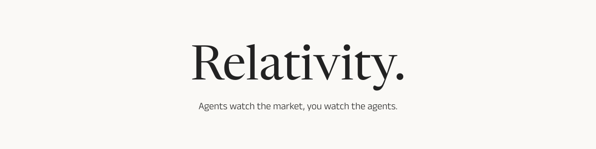

<a id="readme-top"></a>

[![Contributors][contributors-shield]][contributors-url]
[![Forks][forks-shield]][forks-url]
[![Stargazers][stars-shield]][stars-url]
[![Issues][issues-shield]][issues-url]
[![UNLICENSED License][license-shield]][license-url]


<div align="center">
  

  <p>
    AI powered stock market research.
    <br />
    <a href="https://github.com/relativityAI/relativity-portfolio"><strong>Explore the repo »</strong></a>
    <br />
    <br />
    <a href="https://github.com/relativityAI/relativity-portfolio/issues/new?labels=bug&template=bug-report---.md">Report Bug</a>
    &middot;
    <a href="https://github.com/relativityAI/relativity-portfolio/issues/new?labels=enhancement&template=feature-request---.md">Request Feature</a>
  </p>
</div>


<details>
  <summary>Table of Contents</summary>
  <ol>
    <li>
      <a href="#about-the-project">About The Project</a>
      <ul>
        <li><a href="#built-with">Built With</a></li>
      </ul>
    </li>
    <li><a href="#usage">Usage</a></li>
    <li><a href="#skill-creation">Skill Creation</a></li>
    <li><a href="#roadmap">Roadmap</a></li>
    <li><a href="#contributing">Contributing</a></li>
    <li><a href="#license">License</a></li>
    <li><a href="#contact">Contact</a></li>
    <li><a href="#acknowledgments">Acknowledgments</a></li>
  </ol>
</details>


## About The Project

Every investor has a style. We capture it.

Relativity AI Portfolio turns an investing style into an *investor agent* — a set of rules and guidelines that dictate how a stock should be evaluated. Once the agent is configured, the system delegates the research to AI and algorithms. No more endless screen time. No more scattered data. The portfolio does the digging. You do the deciding.

<p align="right">(<a href="#readme-top">back to top</a>)</p>


### Built With

* [![React][React.js]][React-url]
* [![Vite][Vite]][Vite-url]
* [![Chakra UI][Chakra]][Chakra-url]
* [![Express][Express]][Express-url]
* [![Supabase][Supabase]][Supabase-url]

<p align="right">(<a href="#readme-top">back to top</a>)</p>


## Usage

Open [http://localhost:5173](http://localhost:5173).

- **`/new-analysis`** — Pick a source, company, skill, and model, then run an analysis.
- **`/analysis-list`** — Browse saved analysis runs.
- **`/agents`** — View and manage your investor agents.
- **`/my-workspace`** — My Workspace: agent library, skills, builder, and tools.
- **`/settings`** — Store LLM and Voyager API keys, encrypted at rest server-side.

### Example run

Run the harness CLI directly (from `api/`, with `npm run searxng` up and an `OPENCODE_API_KEY` set):

```bash
npx tsx src/harness/cli.ts --real --symbol AAPL --model opencode/deepseek-v4.1-flash --max-steps 20 --max-tokens 30000 --skills chartist-technical-analysis --save-workspace
```

<p align="right">(<a href="#readme-top">back to top</a>)</p>


## Skill Creation

Coming soon.

<p align="right">(<a href="#readme-top">back to top</a>)</p>


## Roadmap

- [ ] Agent runs (multi-skill orchestrated research)
- [ ] Public skill library sharing
- [ ] Portfolio tracking

See the [open issues](https://github.com/relativityAI/relativity-portfolio/issues) for a full list of proposed features (and known issues).

<p align="right">(<a href="#readme-top">back to top</a>)</p>


## Contributing

Contributions are what make the open source community such an amazing place to learn, inspire, and create. Any contributions you make are **greatly appreciated**.

If you have a suggestion that would make this better, please fork the repo and create a pull request. You can also simply open an issue with the tag "enhancement".
Don't forget to give the project a star! Thanks again!

1. Fork the Project
2. Create your Feature Branch (`git checkout -b feature/AmazingFeature`)
3. Commit your Changes (`git commit -m 'Add some AmazingFeature'`)
4. Push to the Branch (`git push origin feature/AmazingFeature`)
5. Open a Pull Request

### Top contributors:

<a href="https://github.com/relativityAI/relativity-portfolio/graphs/contributors">
  
</a>

<p align="right">(<a href="#readme-top">back to top</a>)</p>


## License

Distributed under the UNLICENSED license. All rights reserved.

<p align="right">(<a href="#readme-top">back to top</a>)</p>


## Contact

Relativity AI - [@relativityAI](https://github.com/relativityAI)

Project Link: [https://github.com/relativityAI/relativity-portfolio](https://github.com/relativityAI/relativity-portfolio)

<p align="right">(<a href="#readme-top">back to top</a>)</p>


## Acknowledgments

* [Best-README-Template](https://github.com/othneildrew/Best-README-Template)
* [Google Fonts](https://fonts.google.com) — Newsreader, Anek Latin
* [Vercel AI SDK](https://sdk.vercel.ai)

<p align="right">(<a href="#readme-top">back to top</a>)</p>


<!-- MARKDOWN LINKS & IMAGES -->
[contributors-shield]: https://img.shields.io/github/contributors/relativityAI/relativity-portfolio.svg?style=for-the-badge
[contributors-url]: https://github.com/relativityAI/relativity-portfolio/graphs/contributors
[forks-shield]: https://img.shields.io/github/forks/relativityAI/relativity-portfolio.svg?style=for-the-badge
[forks-url]: https://github.com/relativityAI/relativity-portfolio/network/members
[stars-shield]: https://img.shields.io/github/stars/relativityAI/relativity-portfolio.svg?style=for-the-badge
[stars-url]: https://github.com/relativityAI/relativity-portfolio/stargazers
[issues-shield]: https://img.shields.io/github/issues/relativityAI/relativity-portfolio.svg?style=for-the-badge
[issues-url]: https://github.com/relativityAI/relativity-portfolio/issues
[license-shield]: https://img.shields.io/badge/license-UNLICENSED-blue.svg?style=for-the-badge
[license-url]: https://github.com/relativityAI/relativity-portfolio/blob/main/LICENSE
[React.js]: https://img.shields.io/badge/React-20232A?style=for-the-badge&logo=react&logoColor=61DAFB
[React-url]: https://reactjs.org/
[Vite]: https://img.shields.io/badge/Vite-646CFF?style=for-the-badge&logo=vite&logoColor=white
[Vite-url]: https://vitejs.dev/
[Chakra]: https://img.shields.io/badge/Chakra%20UI-319795?style=for-the-badge&logo=chakraui&logoColor=white
[Chakra-url]: https://chakra-ui.com/
[Express]: https://img.shields.io/badge/Express-000000?style=for-the-badge&logo=express&logoColor=white
[Express-url]: https://expressjs.com/
[Supabase]: https://img.shields.io/badge/Supabase-3FCF8E?style=for-the-badge&logo=supabase&logoColor=white
[Supabase-url]: https://supabase.com/
